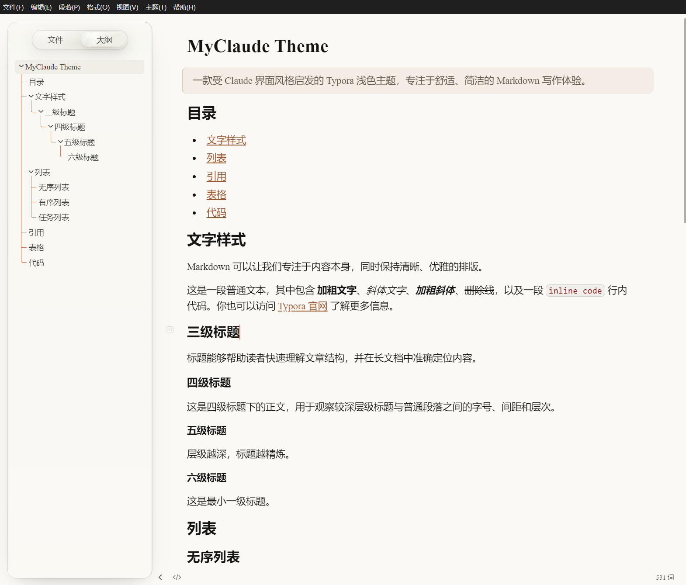
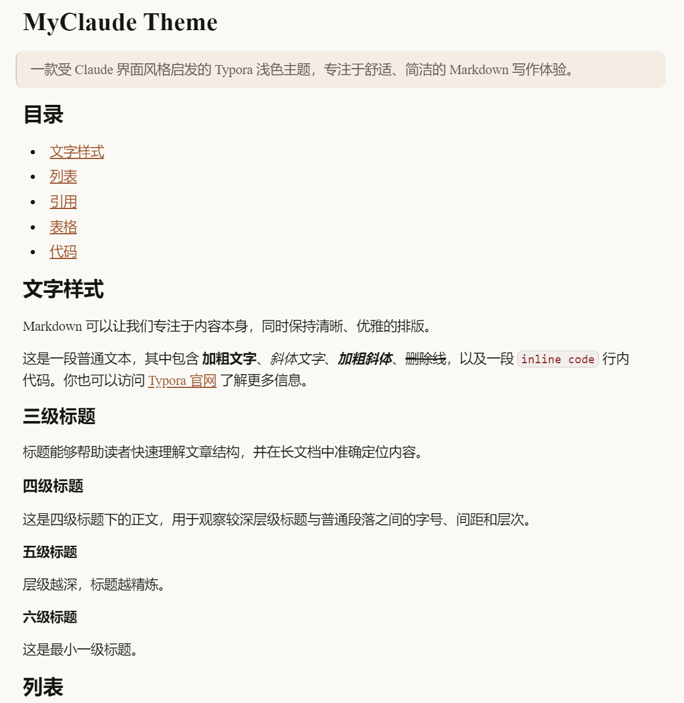
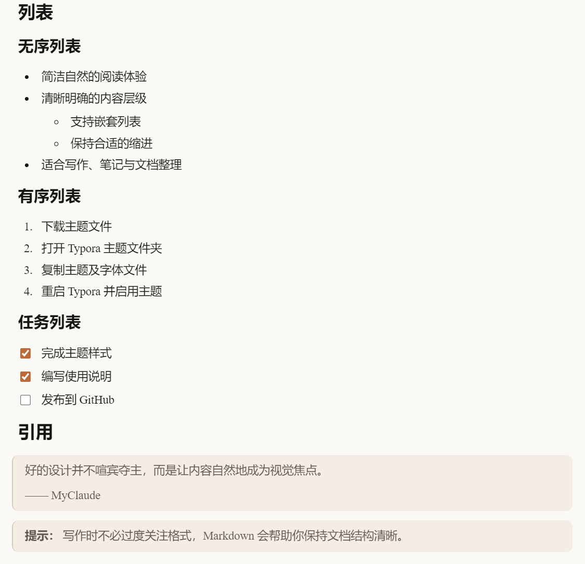
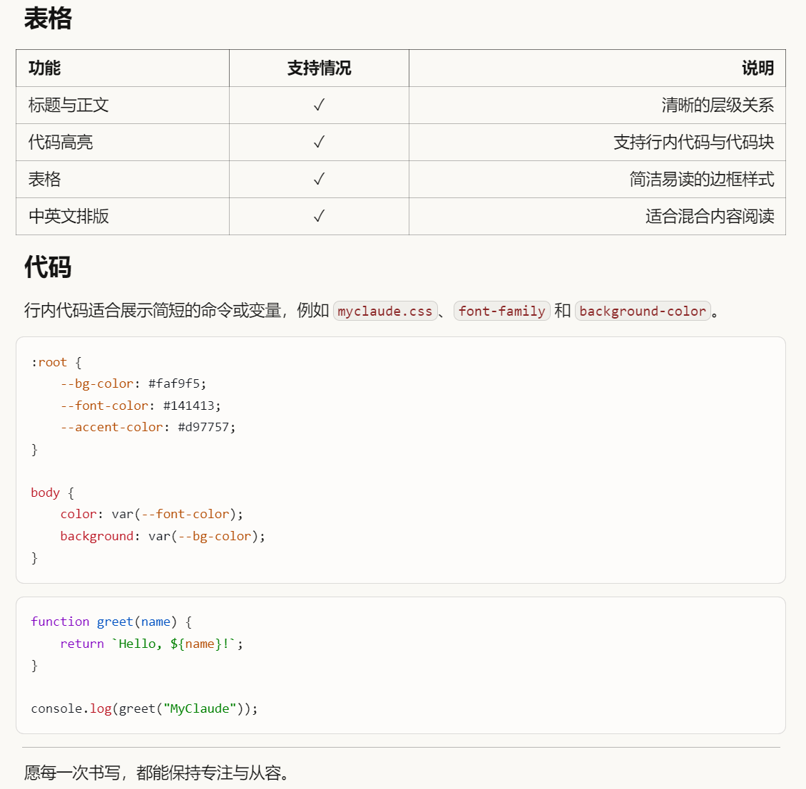

# MyClaude

一款受 Claude 界面风格启发的 Typora 浅色主题。

MyClaude 使用柔和的米白色背景、简洁的排版和舒适的文字间距，适合日常写作、笔记整理与 Markdown 文档阅读。主题同时内置了中英文字体与等宽字体，以尽量保持一致的阅读体验。



> 本项目为个人制作的非官方主题，与 Anthropic 无关。

## 效果预览



------



------



## 使用方法

1. 下载或克隆本仓库。
2. 打开 Typora，依次进入 **偏好设置 → 外观 → 打开主题文件夹**。
3. 将以下内容复制到 Typora 的主题文件夹中：
   - `myclaude.css`
   - `claude_fonts` 文件夹
4. 重启 Typora。
5. 在菜单栏的 **主题** 中选择 **MyClaude**。

## 项目结构

```text
.
├── assets/          # 效果截图等资源
├── claude_fonts/    # 主题所需字体
└── myclaude.css     # 主题样式文件
```

## 说明

- 当前主题为浅色主题。
- 请保留 `myclaude.css` 与 `claude_fonts` 的相对目录结构，否则字体可能无法正常加载。
- 不同操作系统和 Typora 版本下的显示效果可能略有差异。
